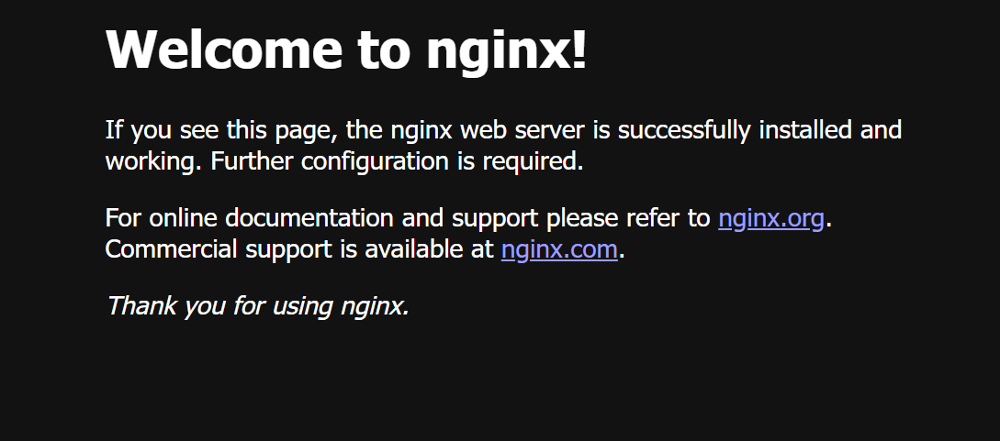

# Lab 2 – Nginx on a VM vs in a Docker container

Comparing the memory used by the same web server (Nginx) running directly on a
Google Cloud VM and inside a Docker container on that VM.

**Result:** Nginx itself costs about the same either way (2.8 MB vs 3.37 MB),
but the container approach also needs the Docker engine, which adds roughly
145–255 MB depending on how memory is measured.

## Environment

| Setting | Value |
| --- | --- |
| Cloud | Google Cloud – Compute Engine |
| Machine | e2-medium (2 vCPU, 4 GB RAM) |
| Zone | europe-west2-c (London) |
| OS | Debian 13 (trixie) |
| Disk | 10 GB balanced persistent disk |

## How to reproduce

1. Create the VM (from Cloud Shell): `bash scripts/create-vm.sh`
2. SSH into the VM and clone this repo.
3. Nginx on the VM: `sudo bash scripts/setup-nginx.sh`, then `sudo bash scripts/measure-memory.sh`
4. Nginx in a container: `sudo bash scripts/setup-docker.sh`, then `sudo bash scripts/measure-memory.sh`
5. Delete the VM when finished: `bash scripts/cleanup.sh`

## Results

| Component | cgroup (systemctl / docker stats) | RSS (ps) |
| --- | --- | --- |
| Nginx on the VM | 2.8 MB | 15.3 MB |
| Nginx in the container | 3.37 MB | 16.8 MB |
| Docker engine (dockerd) | 234.8 MB (incl. page cache) | 98.0 MB |
| containerd | 20.2 MB | 47.5 MB |

Single measurement per method, idle server.

## What I learned

- A container shares the VM's kernel, so the application inside it uses almost
  the same memory as on the host.
- The container engine has a fixed cost; it pays off when many containers share one VM.
- `ps` (RSS) double-counts shared libraries, while `systemctl` and `docker stats`
  use cgroup accounting, so compare like with like.
- Container processes are visible from the host (with different PIDs), and container
  user IDs map directly to host UIDs unless user namespaces are enabled.
- Cloud capacity is finite: the first VM failed with a stockout error in
  europe-west2-a and was created in europe-west2-c instead.

## Tech

Google Cloud Compute Engine · gcloud CLI · Debian · Nginx · Docker · Bash